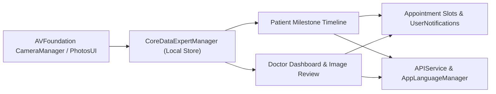

<div align="center">
  

  <h1>HairJourneyTracker</h1>

  <p><b>Native iOS photographic milestone & dermatology consultation platform with AVFoundation capture, PhotosUI comparison galleries, Core Data offline persistence, multi-language localization, and clinician scheduling.</b></p>

  <a href="https://apps.apple.com/in/app/hairjourneytracker/id6760697820">
    
  </a>
  
  
  
</div>

---

## 📱 App Preview

<div align="center">
  <table>
    <tr>
      <td></td>
      <td></td>
      <td></td>
      <td></td>
    </tr>
  </table>
</div>

---

## ✨ Key Capabilities

- **📸 Guided Photographic Time-Lapse**: Custom `CameraManager.swift` (`AVFoundation`) + `PhotosUI` asset ingestion for consistent multi-angle progress tracking.
- **👨‍⚕️ Doctor & Patient Portals**: Complete specialist workflow across 58 Swift files (`DoctorDashboardView`, `DoctorPatientListView`, `DoctorHairImagesView`, `DoctorHairImageDetailView`, `CreateSlotView`, `BookAppointmentView`).
- **💾 Offline-First Core Data Engine**: Local structured storage managed via `CoreDataExpertManager.swift`.
- **🌍 Dynamic Multi-Language Support**: Runtime localization switching powered by `AppLanguageManager.swift`.
- **🔔 Milestone Reminders**: Scheduled `UserNotifications` keeping patients consistent with weekly captures and appointments.

---

## 🏗️ Architecture



---

## 🛠️ Frameworks & Tech Stack

| Layer | Technologies |
| :--- | :--- |
| **UI & Theming** | `SwiftUI`, `UIKit`, `AppTheme.swift`, `ButtonStyles.swift` |
| **Camera & Media** | `AVFoundation`, `PhotosUI`, `WebKit` |
| **Persistence & i18n** | `CoreData`, `AppLanguageManager.swift` |
| **Auth & Scheduling** | `AuthViewModel.swift`, `UserNotifications`, `APIService.swift` |

---

## 🚀 Getting Started

1. Clone the repository:
   ```bash
   git clone https://github.com/vishal-rao28/HairTrackingJournery.git
   cd HairTrackingJournery
   ```
2. Open the Xcode project:
   ```bash
   open HairJourney.xcodeproj
   ```
3. Select an iOS Simulator or physical iPhone and press **`Cmd + R`**.

---

## 👤 Author

**Vishal Rao M** — Native iOS & On-Device AI Architect  
[Live Portfolio](https://vishal-rao28.github.io/Vishal-s-portfolio/) · [GitHub](https://github.com/vishal-rao28) · [Vishal iOS Labs](https://github.com/Vishal-iOS-Labs)
